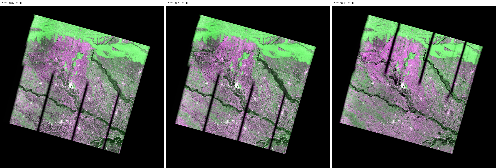

# PROJECT_DWTS

Team repo for NASA Space Apps 2026, challenge **Dancing with the SARS**. Event: 14 to 15 Nov 2026. Submissions close Sunday 15 Nov at 11:59 PM local event time.

## The project

**Wallflower** (working name): finding the flood water that C-band radar can't see, with NISAR L-band data over Bihar's 2026 Gandak flood. It also shows how far to trust each pixel and which villages to check first.

- **[docs/concept.md](docs/concept.md)**: what to build, why, the hypotheses, the 30-second video storyboard, how it maps to the judging criteria. Start here.
- **[docs/playbook.md](docs/playbook.md)**: pre-event checklist with dates, roles, the hour-by-hour plan for the 39 hours, fallbacks, submission checklist.
- [docs/data.md](docs/data.md): verified NISAR scene pairs, reference products and their timing, known data issues.
- [docs/review.md](docs/review.md): the critique of the original research line that led here.
- [docs/literature.md](docs/literature.md): literature matrix and the gap.



Three same-mode NISAR browse images of the Gandak floodplain (track 149, frame 75). The dark vertical bands are swath gaps, and they move between dates.

## Status (3 Nov)

Pre-event. Data located, references located, plan written. No submission code: the Space Apps FAQ asks teams to start the actual work when the hackathon begins.

## Layout

```
data/events.json        candidate events (point, onset, search window)
data/scenes/            ASF query output: every NISAR granule per event, and pairs.csv
data/refs/              CMR query output: Sentinel-1 and optical reference products near each NISAR date
data/manifest.csv       everything to download before the event, with roles and URLs
prep/                   pre-event reconnaissance tools (cite them if used during the event)
  find_scenes.py        search ASF for PROVISIONAL GCOV and pair pre/post scenes
  find_references.py    find DSWx-S1, DSWx-HLS, RTC-S1 and HLS near a NISAR time
  download.py           download manifest rows with an Earthdata login
  quicklook.py          side-by-side of the public browse PNGs for a pair
quicklooks/             saved browse comparisons
docs/
```

## Quickstart

```bash
pip install -r requirements.txt
python prep/download.py --role lead-pre,lead-post --dry-run   # what the lead pair needs
python prep/download.py --role lead-pre,lead-post --out downloads
```

Searching (ASF, CMR) and browse images need no login. Downloads need a free NASA Earthdata account. `downloads/` is git-ignored; the full manifest is about 40 GB of NISAR data plus reference tiles.

Space Apps distributes original submission content under Apache 2.0; add a LICENSE once the team agrees.
