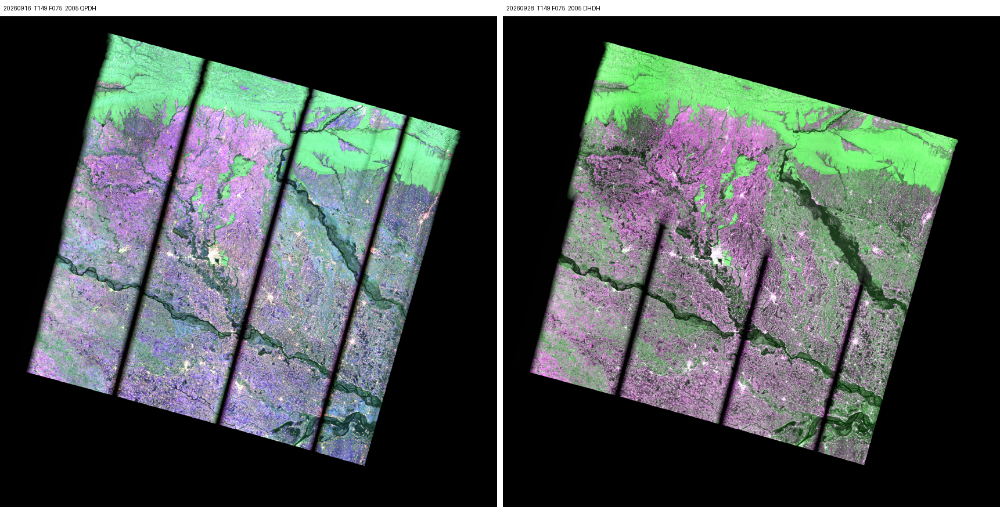

# PROJECT_DWTS

Team repo for NASA Space Apps 2026, challenge **Dancing with the SARS**: an interactive app built on NISAR radar data that tracks surface change. Event: 14 to 15 Nov 2026. Submissions close Sunday 15 Nov at 11:59 PM local time.

## Where things stand (3 Nov)

Pre-event investigation. No submission code yet.

- **Read first:** [docs/review.md](docs/review.md). Verdict on the research line, what to change, go/no-go checks due Sunday 8 Nov.
- [docs/data.md](docs/data.md): verified NISAR availability, real pre/post scene pairs for five 2026 events, references, known issues.
- [docs/literature.md](docs/literature.md): first-pass literature matrix and the gap.
- [docs/plan.md](docs/plan.md): three ranked hypotheses, the minimum viable experiment, the schedule, rules to check.

Lead case: Gandak River flood, Bihar. NISAR track 149 frame 75, 16 Sep → 28 Sep 2026, with Sentinel-1D 11 hours after the post scene.



The browse colors differ because the two dates use different polarization modes (quad-pol, then dual-pol). The dark vertical stripes are most likely SweepSAR swath gaps; see data.md.

## Layout

```
data/events.json          candidate events (point, onset, search window)
data/scenes/              ASF query output: every granule per event, plus pairs.csv
scripts/find_scenes.py    search ASF for PROVISIONAL GCOV and pair pre/post scenes
scripts/quicklook.py      side-by-side of the public browse PNGs for a pair
quicklooks/               saved quicklooks
docs/                     review, data, literature, plan
```

## Quickstart

```bash
pip install -r requirements.txt
python scripts/find_scenes.py data/events.json --out data/scenes
python scripts/quicklook.py <PRE_SCENE_ID> <POST_SCENE_ID> --out quicklooks/pair.png
```

Searching and browse images need no login. Downloading the HDF5 files needs a NASA Earthdata account.

Space Apps distributes original submission content under Apache 2.0; add a LICENSE once the team agrees.
